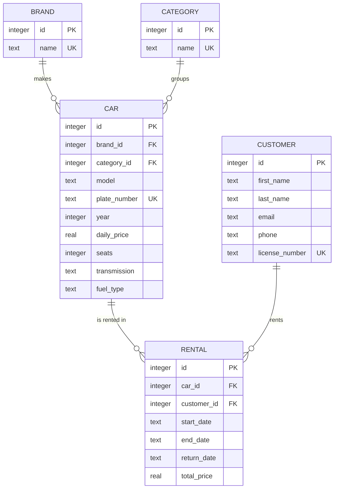

# Database design

The application uses **SQLite**: the whole database is a single file, `carrental.db`,
created automatically in the project folder on the first start. No database server is needed.

- `src/main/resources/db/schema.sql` creates the tables. It runs on every start (`CREATE TABLE IF NOT EXISTS`).
- `src/main/resources/db/seed.sql` adds sample data. It runs only when `carrental.db` does not exist yet.
- `hu.nye.carrental.db.Database` opens the connections and runs both scripts.
  Run its `main` method to check the database: it prints the number of rows in every table.

To start again with fresh sample data, close the application and delete `carrental.db`.

## Entity–relationship diagram

## Tables

| Table | What it stores | Important rules |
|---|---|---|
| `brand` | car manufacturers (Toyota, BMW...) | name is unique |
| `category` | groups of cars (Economy, SUV...) | name is unique |
| `car` | the cars of the fleet | plate number is unique; daily price > 0; gearbox is Manual or Automatic; fuel is Petrol, Diesel, Hybrid or Electric |
| `customer` | the people who rent cars | driving license number is unique; email and phone are optional |
| `rental` | one row for every rental | end date cannot be before the start date |

## Relationships

- Every car belongs to **one brand** and **one category**; a brand or category can have many cars.
- Every rental connects **one car** with **one customer**; cars and customers can have many rentals.
- Foreign keys are switched on for every connection (`PRAGMA foreign_keys = ON`).
  Because of this, a brand, category, car or customer that is still used by other rows **cannot be deleted** –
  the database refuses it and the application shows a message. This protects the rental history.

## How the rental status is stored

There is no "status" column. The status follows from the dates, so it can never get out of sync:

| Status | Condition |
|---|---|
| Active | `return_date` is empty and `end_date` is today or later |
| Overdue | `return_date` is empty and `end_date` is in the past |
| Closed | `return_date` is filled in (and `total_price` is calculated) |

A car is **available** when it has no rental with an empty `return_date`.
The index `idx_rental_car_return` makes this check fast.

Dates are stored as text in `yyyy-MM-dd` format, because SQLite has no date type;
in this format, comparing the text also compares the dates correctly.

## Sample data

On the first start `seed.sql` adds 8 brands, 6 categories, 12 cars, 6 customers and 7 rentals
(3 closed, 3 active, 1 overdue). The rental dates are calculated from the current date
(for example `date('now', '-2 days')`), so the sample always shows every status.
Rows are linked by name, plate number and license number instead of ids, so the script
does not depend on the order in which ids are generated.
